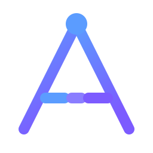

<div align="center">



# ActionFlow

**端侧流式人体原子动作识别引擎**

`一段真人视频 → 带精确时间戳的结构化动作序列`

[](pyproject.toml)
[](pyproject.toml)
[](pyproject.toml)
[](pyproject.toml)
[](https://onnxruntime.ai/)
[](https://arxiv.org/abs/2303.05499)
[](https://arxiv.org/abs/1706.03762)
[](https://ieeexplore.ieee.org/document/433255)
[](LICENSE)
[](.github/workflows/ci.yml)
[](tests/)

</div>

---

## 这是什么

ActionFlow 是一个**端侧可跑的流式人体动作识别引擎**。

输入一段真人视频（或摄像头实时流），它输出的不是「这段视频是吃饭」这样一个标签，
而是**一串带精确起止时间戳的动作序列**：

```json
[
  {"start": 0.00, "end": 1.24, "label": "左举手",  "confidence": 0.94},
  {"start": 1.24, "end": 2.51, "label": "右握拳",  "confidence": 0.91},
  {"start": 2.51, "end": 3.88, "label": "左踢腿",  "confidence": 0.87}
]
```

这个输出形态是**端侧行为理解**的基础 —— 它能直接喂给上层应用去做告警、
交互触发、康复训练评估、跌倒检测这类需要「**什么时候发生了什么**」的场景。

### 三个层次的定位

| 层次 | 做的事 | 典型场景 |
|---|---|---|
| **流式** | 边来帧边出结果，已输出的结论不会被后来的帧改写 | 摄像头实时、直播流 |
| **原子动作** | 识别「左举手」「右踢腿」这种基本动作，而不是「吃饭」这种复合行为 | 人机交互、行为监测 |
| **帧级时间戳** | 每个动作的起止精确到「第几帧到第几帧」 | 需要时间对齐的下游任务 |

### 和常规动作识别项目的区别

常规动作识别项目大多止步于「整段视频 → 一个标签」。
ActionFlow 把这件事拆成三层，每层各自解决一个明确的问题：

```
┌─────────────────────────────────────────────────────────────────┐
│  Layer 1   姿态估计   Human Pose Estimation                     │
│            RTMPose (ONNX) → 17 关键点                          │
│            One-Euro Filter → 去抖                               │
│            身体坐标系归一化 → 位置/尺度/朝向不变                  │
└─────────────────────────────────────────────────────────────────┘
                          ↓ 骨架流 [T, 17, 3]
┌─────────────────────────────────────────────────────────────────┐
│  Layer 2   动作分类   Action Recognition                         │
│            关节 Embedding + 时间位置编码                        │
│            nn.TransformerEncoder (2 层, d=128)                  │
│            因果注意力掩码 → 前缀不变性实测 0.0                   │
│            Key-Padding Mask → 处理关键点漏检                     │
└─────────────────────────────────────────────────────────────────┘
                          ↓ 逐帧概率 [T, C] + 边界距离 [T, 2]
┌─────────────────────────────────────────────────────────────────┐
│  Layer 3   时序解码   Temporal Action Localization              │
│            Viterbi 动态规划 → 全局最优路径                       │
│            Hysteresis 双阈值 → 抗边界抖动                        │
│            最小持续时长约束 → 滤除假阳性                        │
│            边界回归修正 → 把迟到的边界拉回来                     │
└─────────────────────────────────────────────────────────────────┘
                          ↓
  [{"start":0.0, "end":1.2, "label":"左举手", "confidence":0.94}, ...]
```

**②③ 缺一不可**：只有 ①②，你知道每帧是什么，但输出是碎帧、没有时间戳；
只有 ①③，你能切出段，但不知道每段是什么动作。

### 算法与论文出处

| 层 | 算法 | 解决的问题 | 出处 |
|---|---|---|---|
| Layer 1 | **RTMPose** + SimCC | 从像素定位 17 个关节 | [RTMPose, ICCV 2023](https://arxiv.org/abs/2303.05499) / [SimCC, ICCV 2021](https://arxiv.org/abs/2108.07936) |
| Layer 1 | **One-Euro Filter** | 检测抖动让骨长特征剧烈变化 | [Casiez et al., CHI 2012](https://dl.acm.org/doi/10.1145/2207673.2208636) |
| Layer 1 | 身体坐标系归一化 | 位置 / 体型 / 朝向不应影响动作语义 | 几何先验 |
| Layer 2 | **Self-Attention / Transformer** | 建模任意两个关节、任意两个时刻的关系 | [Vaswani et al., NeurIPS 2017](https://arxiv.org/abs/1706.03762) |
| Layer 2 | **因果注意力掩码** | 实时流里已输出的结果不能被后来的帧改写 | Transformer decoder mask（Vaswani 2017） |
| Layer 2 | **Key-Padding Mask** | 低置信度关节不应污染判断 | 标准 attention masking |
| Layer 3 | **Viterbi 动态规划** | 孤立误判把连续动作劈成两半 | [Rabiner, IEEE ASSP 1989](https://ieeexplore.ieee.org/document/433255) |
| Layer 3 | **Hysteresis 双阈值** | 单一阈值下边界反复抖动 | 迟滞回环，同 [Canny, 1986](https://ieeexplore.ieee.org/document/376740) |
| Layer 3 | **边界回归头** | 阈值法判定边界天然偏晚 | 借鉴 [ActionFormer, ICCV 2021](https://arxiv.org/abs/2208.05374) 的边界回归思想 |
| Layer 3 | Softplus 保正回归 | 「距边界还有几帧」必须非负 | — |
| 融合 | **Cross-Attention** | 骨架看到几何，看不到语义 | [Vaswani et al., ICLR 2018](https://arxiv.org/abs/1803.06155) |
| 部署 | **ONNX Runtime** | 端侧推理引擎 | [Microsoft, MIT](https://onnxruntime.ai/) |

> **完整算法对比、选型依据、以及「为什么不用 ST-GCN / 视频大模型」的讨论**
> 见 [`docs/technical-plan.html`](docs/technical-plan.html)。

### 工程指标

| 指标 | 实测 |
|---|---|
| 分类器参数量 | **0.294M**（INT8 量化后约 0.9MB） |
| 端到端速度 | **35.4 fps** @ M 系列 CPU（视频原速 29.9fps，**含姿态提取**） |
| 前缀不变性差异 | **0.0**（逐位相同） |
| 部署形态 | 单个 ONNX 文件，onnxruntime 直接跑，不需要 PyTorch |

> 端侧部署的真正瓶颈是**姿态提取**（RTMPose，54MB），不是分类器。
> 分类器只有 1.12MB —— 因为它的输入是「17 个关节 × 3 个数」，不是像素。

### 数据闭环

公开数据集（NTU RGB+D / Kinetics）无法直接使用：没有「原子动作」粒度、
没有边界标注、场景也不匹配。因此本仓库提供**从录制到训练的全套工具**：

```
录制视频 → 自动抽关键点 → GUI 标注 → 质量校验 → 导出训练窗口 → 按人划分 → 训练 → 段级评估
```

完整流程见下方 [Step 0 ~ Step 11](#完整数据到模型工作流)。

---

## 目录

- [这是什么](#这是什么)
- [核心特性](#核心特性)
- [三分钟跑通](#三分钟跑通)
- [完整数据到模型工作流](#完整数据到模型工作流) ← **数据怎么做在这**
  - [Step 0 · 准备环境](#step-0--准备环境)
  - [Step 1 · 确定动作清单](#step-1--确定动作清单)
  - [Step 2 · 录制视频](#step-2--录制视频)
  - [Step 3 · 视频放进哪个文件夹](#step-3--视频放进哪个文件夹)
  - [Step 4 · 抽取关键点](#step-4--抽取关键点)
  - [Step 5 · 标注动作段](#step-5--标注动作段)
  - [Step 6 · 校验标注质量](#step-6--校验标注质量)
  - [Step 7 · 导出训练窗口](#step-7--导出训练窗口)
  - [Step 8 · 生成标签表和划分](#step-8--生成标签表和划分)
  - [Step 9 · 训练](#step-9--训练)
  - [Step 10 · 验证模型](#step-10--验证模型)
  - [Step 11 · 推理和导出](#step-11--推理和导出)
- [四种模型架构](#四种模型架构)
- [想读代码？](#想读代码)
- [项目结构](#项目结构)
- [设计要点](#设计要点)
- [相关技术](#相关技术)
- [开发](#开发)
- [路线图](#路线图)
- [License](#license)

---

## 核心特性

| | |
|---|---|
| **真正的流式** | 因果注意力掩码，**前缀不变性实测差异 = 0.0**（逐位相同） |
| **精确到帧的时间戳** | 边界回归头（借鉴 ActionFormer），不只是置信度跨阈值 |
| **端侧可跑** | streaming 架构 **0.29M 参数**，权重 1.12MB，ONNX 导出 |
| **自带数据工具** | 自动抽关键点 + GUI 标注 + 质量校验 + 段级评估 |
| **四种架构** | `offline` / `streaming` / `boundary` / `fusion`，一个开关切换 |
| **八个手写/关键算法** | One-Euro、归一化、因果掩码、Viterbi、Hysteresis、边界回归…… |
| **工程完整度** | 124 个单元测试 · CI · 段级评估 · 四种架构全部可导出 ONNX |

---

## 三分钟跑通

**不需要**任何权重、不需要数据集、不需要网络。

```bash
git clone https://gitee.com/lang_junnan_admin/actionflow.git
cd actionflow

python3 -m venv .venv
source .venv/bin/activate
pip install -e ".[all]"

bash scripts/demo.sh
```

`demo.sh` 会依次：生成合成视频 → 流水线自检 → 解码算法演示 → 四种架构演示 → 跑完 124 个测试。

也可以单跑：

```bash
python -m actionflow.cli decode-test      # 解码算法演示（纯 numpy）
python tools/verify_pipeline.py            # 端到端自检
python examples/architectures.py           # 四种架构演示
python -m pytest tests/ -q                 # 124 个测试
```

---

## 完整数据到模型工作流

> **这一章是本 README 的重点。**
> 前面讲「这个项目做什么」，这一章讲「**你今天怎么就能跑出自己的模型**」。

### 全流程一览

```
   ①定动作清单  ②录视频  ③放文件夹  ④抽关键点  ⑤标注
        ↓                                          ↓
    labels.txt                            data/annotations/*.json
                                               ↓
                                     ⑥校验 → ⑦导出窗口
                                               ↓
                                    data/windows/*.npz
                                               ↓
                              ⑧建标签表+按人划分 → ⑨训练
                                               ↓
                                        weights/*.pth
                                               ↓
                                    ⑩段级评估 → ⑪推理/导出
```

---

### Step 0 · 准备环境

```bash
python3 -m venv .venv
source .venv/bin/activate
pip install -e ".[all]"
```

**姿态模型权重**（必需，54MB，仓库不带）：

```bash
# RTMPose-m，COCO-17 人体版
# 来源: https://huggingface.co/bukuroo/RTMPose-ONNX  →  rtmpose-m.onnx
mkdir -p weights
mv rtmpose-m.onnx weights/
```

> 仓库里自带的 `weights/mock-pose.onnx`（28KB）**只能跑通流程**，
> 它输出的关键点是假的，**不能用来训模型**。
> 真实权重是 Apache-2.0，可以放心用。

验证环境：

```bash
python -c "import torch, onnxruntime, cv2; print('OK', torch.__version__)"
```

---

### Step 1 · 确定动作清单

**先想清楚要识别哪些动作。** 这是整个项目最关键的一步 —— 动作定义模糊，后面所有标注都会白做。

**原子动作的标准**：

| ✅ 好的原子动作 | ❌ 复合动作 | 原因 |
|---|---|---|
| 左举手 / 右举手 | 打招呼 | 打招呼 = 举手 + 转身 + 说话 |
| 左踢腿 / 右踢腿 | 跑步 | 跑步 = 抬腿 + 落地 + 摆臂 × N |
| 胸前摆动 | 健身 | 健身是无限种动作的集合 |
| 左敬礼 / 右敬礼 | 敬礼 | 敬礼 = 举手 + 立正 + 保持 |
| 握拳 / 摊掌 | 手势 | 手势的种类无限 |

**推荐起步规模**：**5~10 个动作**。

- 少于 5 个 → 容易过拟合，换个人就崩
- 多于 10 个 → 每个类能分到的标注时间不够，而且你自己也标不动

写进一个文件，标注时要用：

```bash
# labels.txt —— 每行一个动作名，中文或英文都行
左举手
右举手
胸前摆动
左踢腿
右踢腿
左敬礼
右敬礼
```

> **⚠️ 动作名一旦定下来就别改了。**
> 后面 `labels.json` 里的 `label_to_id` 是按**样本数降序**排的 ——
> 改了动作名，id 就会错位，**之前训的权重直接作废**。

---

### Step 2 · 录制视频

这是最容易出问题的一步。**录之前请务必读完这一节。**

#### 器材与机位

| 项目 | 要求 | 为什么 |
|---|---|---|
| **机位** | **固定**！不许动 | 模型学的是相对躯干的姿态，机位一变，「左」和「右」就反了 |
| **距离** | 全身入镜，**距人 2.5~4 米** | 太近脚会被裁掉（踢腿类直接废） |
| **角度** | **正面**，可以略偏 ±15° | 侧面会丢失左右手信息 |
| **高度** | 镜头在**胸口高度** | 俯拍会压缩躯干，膝关节角度失真 |
| **背景** | 干净、纯色、少杂物 | 背景纹理会干扰姿态模型 |
| **光线** | 均匀、无频闪、无逆光 | 阴影会让关键点抖动 |
| **帧率** | **固定 30fps**，全程不变 | 变化会让时间戳算错 |
| **分辨率** | 1080p 即可 | RTMPose 内部缩到 192×192，4K 是浪费 |

#### 动作怎么录

- **每个动作 3 秒左右**，最短 2 秒（≥60 帧）
  - 太短 → 切不出完整的 32 帧训练窗口
  - 太长 → 标注时容易手滑，边界误差变大
- **段与段之间回立正停 1 秒**
  - 这个静止间隙很重要，它是动作之间的**自然分隔**
- **一条视频排 6~12 个动作段**，总时长 45~60 秒
- **每个动作在一条视频里出现 1 次**；想重复出现就录多条视频

#### 录制的黄金准则

```
✅ 开头留 2 秒静止  → 给模型「待机」的参照
✅ 每个动作前留 1 秒静止
✅ 每个动作后留 1 秒静止
✅ 动作做完整 —— 不要只做一半（抬手抬到一半就放下 = 没标注价值）
✅ 速度自然 —— 不要刻意放慢或加快
✅ 手臂不要贴身体太近 —— 关键点会分不清前后
❌ 不要穿宽松长袖 —— 会遮挡肘腕关键点
❌ 不要快速甩手 —— 超出 30fps 的采样率会产生混叠
❌ 不要跳帧剪辑 —— 帧号和标注对不上
```

> **⚠️ 左右手判定**（最容易搞错的地方）：
> 面对镜头时，**你的左手在画面的右边**。
> 标注时用 GUI 里叠加的骨架线核对，不要靠记忆。
> 这是自建数据集最常见的错误来源，而且错了很难发现。

#### 录多少才够

| 数据量 | 效果 |
|---|---|
| 1 人 × 5 条 | **不要开训**。模型只会「记住这个人」 |
| 3 人 × 5 条（15 条） | 起步下限。约 900 个窗口 |
| 5 人 × 10 条（50 条） | 比较像样。每类 30+ 样本 |
| 10 人 × 10 条（100 条） | 真正意义上的跨人泛化 |

> **多人 > 多人录更多条。**
> 换一个人就认不出来，通常不是模型太小，是**数据里只有一种体型**。
> 身高、体型、衣着、发型有差异，模型才学得到「动作」而不是「这个人」。

---

### Step 3 · 视频放进哪个文件夹

**目录约定**（`.gitignore` 已经把 `data/` 整个排除了，**你的数据不会被误传到仓库里**）：

```
actionflow/
└── data/
    ├── clips/          ← ① 你录的原始视频放这里
    │   ├── s01_a.mp4   ←    命名：<人号>_<编号>.mp4
    │   ├── s01_b.mp4
    │   ├── s02_a.mp4   ←    s02 是第二个人
    │   └── ...
    ├── npz/            ← ② 抽关键点后自动生成
    ├── annotations/    ← ③ 标注后自动生成
    ├── windows/        ← ④ 导出训练窗口后自动生成
    ├── labels.json     ← ⑤ 标签表（自动生成）
    └── splits/         ← ⑥ 训练/测试划分（自动生成）
```

**只放 `data/clips/`，其他四个目录都会自动生成。**

#### 命名规则（**必须遵守**）

```
<人号>_<任意编号>.mp4
 │      └─ 同一个人的不同片段，随便起名
 └──────── 受试者编号：s01, s02, s03 ...
```

**下划线前的 `s01` 会被当作「受试者编号」，训练/测试集按人切分。**

```bash
# 正确
data/clips/s01_a.mp4
data/clips/s01_b.mp4
data/clips/s02_a.mp4

# 错误 ❌ —— 没有下划线分隔，所有人会被当成同一个人
data/clips/person1.mp4
data/clips/clip1.mp4
```

> **⚠️ 同一个人的片段绝不能同时出现在训练集和测试集。**
> 否则模型学到的是「记住这个人的样子」而不是「识别这个动作」，
> 测试精度会**虚高好几个百分点** —— 这是自建数据集最常见的自欺欺人。

---

### Step 4 · 抽取关键点

先确认姿态权重就位：

```bash
ls -lh weights/rtmpose-m.onnx     # 应该在 50MB 左右
```

然后**每个视频一条命令**：

```bash
python -m actionflow.data.annotate_cli extract \
    --video data/clips/s01_a.mp4 \
    --out   data/npz/s01_a.npz
```

输出示例：

```
正在从 data/clips/s01_a.mp4 抽取关键点...
✓ 已保存: data/npz/s01_a.npz   shape=(1638, 17, 3)
  置信度: 均值 0.874, 低于 0.3 的点占 4.2%
```

**看置信度统计** —— 这是判断「这段视频能不能用」的唯一客观信号：

| 漏检率 | 含义 | 怎么办 |
|---|---|---|
| < 10% | 很好 | 继续 |
| 10~30% | 可以接受 | 继续，但标注时留意遮挡关节 |
| **> 30%** | ⚠️ **有问题** | 见下 |

漏检率 > 30% 时，**先别标**，先检查：

1. 画面里人是不是太小 → 走近一点重录
2. 是不是逆光 / 背景太杂 → 换环境重录
3. 是不是穿宽松长袖挡住了关节 → 换衣服重录

**批量处理**（一条命令跑完所有视频）：

```bash
for f in data/clips/*.mp4; do
    n=$(basename "$f" .mp4)
    python -m actionflow.data.annotate_cli extract \
        --video "$f" --out "data/npz/$n.npz"
done
```

> 抽关键点是 CPU 上最慢的一步（54MB 的 RTMPose，1 分钟视频约 1~2 分钟）。
> 抽完后这些 npz 会**重复利用** —— 之后标注、导出、训练都不用再碰视频了。

---

### Step 5 · 标注动作段

#### 方式 A：GUI 标注（推荐）

```bash
python -m actionflow.data.annotate_cli gui \
    --video  data/clips/s01_a.mp4 \
    --npz    data/npz/s01_a.npz \
    --out    data/annotations/s01_a.json \
    --labels 左举手,右举手,胸前摆动,左踢腿,右踢腿,左敬礼,右敬礼
```

> `--labels` 用逗号分隔，给出候选标签；界面上可以用 `L` 键循环切换。
> **GUI 需要 pillow**：`pip install -e ".[gui]"`（macOS 系统自带 tkinter）。
> 不想开图形界面就用方式 B。

#### GUI 快捷键

| 键 | 作用 |
|---|---|
| `空格` | 播放 / 暂停 |
| `←` `→` | 上一帧 / 下一帧（`Shift+←/→` 跳 10 帧） |
| `Home` / `End` | 跳到开头 / 结尾 |
| `A` | 把当前帧设为**动作段起点** |
| `D` | 设为终点并保存这一段（没设起点就自动用当前帧） |
| `L` | 在候选标签里循环切换（也可直接点右下角下拉框） |
| `Enter` | 保存当前段 |
| `Delete` | 删除列表中选中的段 |
| `Ctrl+S` | 保存标注文件（**中途退出前先按这个**，下次打开自动续标） |
| `Ctrl+Q` | 退出 |

#### 标注要点（**照做，别偷懒**）

- **起点** = 肢体**离开身侧**的第一帧
- **终点** = 完全**放回 / 落地**的最后一帧
- 前后的静止段**不要圈进来** —— 静止是另一个类别
- **画面上叠加的骨架线**用来核对左右手（面对镜头时，**你的左手在画面右边**）
- 宁可信**骨架**，不信肉眼 —— 肉眼在 30fps 下很难判断「手到底离身了没有」

#### 方式 B：命令行标注（无 GUI 环境）

```bash
python -m actionflow.data.annotate_cli cli \
    --video data/clips/s01_a.mp4 \
    --npz   data/npz/s01_a.npz \
    --out   data/annotations/s01_a.json
```

```
逐条输入动作段(空行结束):
  格式: <标签> <起始帧> <结束帧>

> 左举手 207 407
  ✓ 已添加 左举手 [207, 407)
> 右举手 447 605
  ✓ 已添加 右举手 [447, 605)
> 胸前摆动 677 854
  ✓ 已添加 胸前摆动 [677, 854)
> (空行结束)
```

> **怎么快速拿到帧号？** 先用 GUI 走一遍，标完读 JSON 里的
> `start_frame` / `end_frame`，然后用命令行批量补。或者直接看
> `data/npz/s01_a.npz` 里的帧号对应视频时间：`帧号 = 秒数 × fps`。

---

### Step 6 · 校验标注质量

```bash
python -m actionflow.data.annotate_cli validate \
    --annotations data/annotations \
    --npz-dir    data/npz
```

输出示例：

```
  标注文件: 9
  视频数:   9
  动作段:   63
  类别数:   7

  类别分布:
    左举手                 9  ████████████████████████████████████████
    右举手                 9  ████████████████████████████████████████
    ...

  ⚠️  1 个警告:
     - 有类别样本数少于 10 个(最少 9 个)—— 建议至少 30 个/类再开训

  ✓ 没有发现结构性问题
```

**这个工具检查什么**：

| 检查项 | 说明 |
|---|---|
| 段重叠 | 同一个视频里两段时间交叠了 |
| 越界 | 段的帧号超出了视频长度 |
| 长度非法 | 结束帧 ≤ 起始帧 |
| 类别不均衡 | 某类样本数远少于其他类 |
| 样本太少 | 某类只有 2~3 个样本就敢开训，必翻车 |
| 关键点缺失 | 标注声明了 npz 但文件不存在 |
| 形状错误 | npz 的关键点数不是 17 |

**退出码**：`0` = 没问题，`1` = 有问题。可以在 CI 里直接用。

> **⚠️ 「每类至少 30 个样本」不是建议，是门槛。**
> 少于 30 个的类别，模型基本学不会 —— 但训练时不会报错，
> 你只会看到那个类的准确率接近 0。**先补数据，别急着训。**

---

### Step 7 · 导出训练窗口

```bash
python -m actionflow.data.annotate_cli export \
    --annotations data/annotations \
    --npz-dir      data/npz \
    --out          data/windows
```

输出：

```
✓ 导出 351 个窗口到 data/windows

  类别分布:
    胸前摆动                70   19.9%
    左举手                  60   17.1%
    右举手                  53   15.1%
    ...
```

**发生了什么**：每个动作段被切成 **32 帧**的窗口（步长 16），
每个窗口存成一个 npz：

```
data/windows/s01_a__左举手__000207.npz
             │      │       └── 起始帧号
             │      └── 动作标签
             └── 视频名
```

> **32 帧窗口 = 1.07 秒**（@30fps）。这是模型的时间分辨率，
> 也是流式推理的延迟下限。想更细就调小 `--window`，
> 但窗口太短时，一个完整动作可能跨不过一个窗口。

---

### Step 8 · 生成标签表和划分

```bash
python scripts/rebuild_maps.py
```

输出：

```
{'胸前摆动': 0, '左举手': 1, '右举手': 2, '左敬礼': 3, '右敬礼': 4, '右踢腿': 5, '左踢腿': 6}
{'num_subjects': 3, 'train_subjects': 2, 'test_subjects': 1,
 'num_train': 255, 'num_test': 96, 'test_subject_ids': ['s03']}
```

这一步做两件事：

1. **标签表** `data/labels.json` —— 标签名 ↔ 整数 id 的映射
   （按**样本数降序**排，保证可复现；id 0 是最常见的类）
2. **按人划分** `data/splits/{train,test}.txt` —— 测试集取编号靠后的受试者

> **⚠️ 每次重新导出窗口后都要重跑这个脚本。**
> 标签 id 会变，旧的权重就对不上了。

---

### Step 9 · 训练

```bash
python -m actionflow.train \
    --data          data/windows \
    --dataset-type  annotated \
    --annotations   data/annotations \
    --labels-json   data/labels.json \
    --splits        data/splits \
    --arch          streaming \
    --epochs        60 \
    --lr            1e-3 \
    --batch-size    16 \
    --out           weights/my_action.pth
```

训练输出：

```
设备: cpu
模型架构: streaming
训练样本: 255  测试样本: 96
类别数: 7  标签: ['胸前摆动', '左举手', ...]
模型参数量: 0.294M
epoch   0 | loss 1.8321 | acc  8.29% | 3.2s
epoch  10 | loss 0.7845 | acc 65.62% | 3.3s
epoch  30 | loss 0.7102 | acc 78.12% | 3.3s
epoch  59 | loss 0.6982 | acc 79.65% | 3.3s
  ✓ 保存最优模型 (acc=79.65%) → weights/my_action.pth
```

**训练产物**（三个文件，**必须一起用**）：

| 文件 | 内容 |
|---|---|
| `weights/my_action.pth` | 模型权重 |
| `weights/my_action.config.json` | 训练时的配置（类别数、窗口、阈值……） |
| `weights/my_action.history.json` | 逐 epoch 的 loss / acc 曲线 |

> **⚠️ `config.json` 是必需的。**
> 推理时用它还原类别数、标签表和解码阈值。
> 少了它，用 7 类权重去建 60 类的模型会直接 `size mismatch` 崩掉。
> （配置里存的是**相对路径**，权重可以跟着仓库在机器之间跑。）

#### 训练参数怎么选

| 参数 | 建议 | 说明 |
|---|---|---|
| `--lr` | **`1e-3`** | ⚠️ 自建小数据集用默认值 1e-4 **收敛极慢** |
| `--epochs` | 60~100 | 小数据集几十个 epoch 就够，再多会过拟合 |
| `--batch-size` | 16 | 数据少的时候 batch 别太大 |
| `--arch` | `streaming` | 想要更准的时间戳换 `boundary` |
| `--boundary-weight` | **别动**（默认 0.1） | 调大到 0.3 会把分类准确率压死 |

#### ⚠️ 只有 1 个人时会怎样

按人划分需要至少 2 个人。**只有 1 个人时测试集会是空的**，
训练会自动退回「随机留出 20% 窗口」，并打警告：

```
⚠️ 测试集为空(数据只有 1 个人,无法按人划分)。
  已退回随机留出 72 个窗口做测试 —— 这个准确率只能说明模型记住了你,
  不代表换个人也认得出。
```

**这个数字没有参考价值。** 想看真实的跨人泛化，**必须找第二个人录数据**。

---

### Step 10 · 验证模型

**这一步不能省。** 训练日志里的「帧级准确率」和你真正关心的
「**动作段找对了吗、边界准吗**」是两回事。

```bash
python -m actionflow.evaluate \
    --model       weights/my_action.pth \
    --annotations data/annotations \
    --npz-dir     data/npz \
    --videos      data/clips \
    --out         output/eval.json
```

输出：

```
========================================================================
段级评估报告
========================================================================

视频数: 9
真值段: 63   预测段: 21   命中: 5

── 核心指标 ──
  Precision     23.81%  ███████░░░░░░░░░░░░░░░░░░░░░░
  Recall         7.94%  ██░░░░░░░░░░░░░░░░░░░░░░░░░░░░
  F1            11.90%  ████░░░░░░░░░░░░░░░░░░░░░░░░░░░░
  类别准确率         19.05%  ██████░░░░░░░░░░░░░░░░░░░░░░░░░░░

── 时间戳精度 ──
  平均 IoU           0.2305
  平均边界误差       143.20 帧
  边界误差中位数     101.50 帧
  (30fps 下 4773 ms)

── 逐视频 ──
  s01_a                    GT=  7 PRED=  2 命中=  1  F1= 22.22%  IoU=0.116  边界误差=304.5帧
  ...
```

#### 四个核心指标怎么读

| 指标 | 含义 | 低了说明什么 |
|---|---|---|
| **Precision** | 预测的段里有多少是真的 | 误检多 → 解码阈值太松，或模型在瞎报 |
| **Recall** | 真值段里有多少被找到了 | 漏检多 → 阈值太严，或压根没学到这个动作 |
| **类别准确率** | 动作**认对了**吗（不管边界） | 低 → 分类没学好，**数据量或学习率的问题** |
| **平均边界误差** | 时间戳偏了多少帧 | 大 → 边界回归头没训好，或该换 `--arch boundary` |

**段匹配规则**：类别相同 + 有重叠（IoU > 0.1），**贪心最大 IoU**，
一个真值段不会被两个预测段重复占用。
（所以「把一个动作切成三段」会算成 1 命中 + 2 误检，而不是 3 命中。）

#### 排查表

| 症状 | 大概率原因 | 怎么办 |
|---|---|---|
| 类别准确率低 | **数据不够 / 学习率不对** | 确认 `--lr 1e-3`；补数据到每类 30+ 样本 |
| 类别对但边界差 | 时间戳精度不够 | 换 `--arch boundary` 重训 |
| 预测段比真值少很多 | 解码阈值太严 | 调低 `decode.high_threshold`（0.7 → 0.6） |
| 预测段比真值多很多 | 误检 | 调高 `high_threshold`，或补「静止」类 |
| 边界整体偏移 | 起点/终点系统性地早或晚 | 标注的起点定义不统一，重新核对一遍 |

> **💡 强烈建议加一个「静止」类。**
> 视频里大量时间是人站着不动。没有这个类时，静止间隙会被模型
> 归给相邻的动作，边界被拉长、段数偏少 —— 这正是上表里
> 「预测段比真值少」的典型原因。
>
> ```bash
> python scripts/add_rest_class.py   # 自动把动作段之间的空隙补成「静止」段
> ```
> 补完记得**重跑 Step 7 和 Step 8**（导出 + 重建标签表）。

#### 验证匹配规则本身

不跑模型，直接把真值当成预测，验证评估逻辑没写错：

```bash
python -m actionflow.evaluate \
    --annotations data/annotations --npz-dir data/npz --videos data/clips --oracle
```

应该全是 **100%**。如果不是，说明评估工具本身有问题，别去怀疑模型。

---

### Step 11 · 推理和导出

#### 推理

```bash
# 离线：整段处理，时间戳最准
python -m actionflow.cli infer \
    --video data/clips/s02_a.mp4 \
    --model weights/my_action.pth \
    --out   output/result.json
```

```json
[
  {"start": 0.37, "end": 0.90, "duration": 0.53, "label": "右敬礼", "label_id": 4, "confidence": 0.717},
  {"start": 0.90, "end": 2.67, "duration": 1.77, "label": "右举手", "label_id": 2, "confidence": 0.922}
]
```

```bash
# 可视化：边播边叠加骨架和动作时间轴
python -m actionflow.cli infer \
    --video data/clips/s02_a.mp4 \
    --model weights/my_action.pth \
    --show --save output/vis.mp4
```

```bash
# 摄像头实时
python -m actionflow.cli live --device 0 --model weights/my_action.pth
```

#### 导出 ONNX（端侧部署）

```bash
python -m actionflow.export \
    --model weights/my_action.pth \
    --out   weights/my_action.onnx
```

```
✓ 导出成功: weights/my_action.onnx
  架构: streaming（专用导出器,窗口长度固定为 32）
✓ 导出成功: weights/my_action.onnx
  参数量: 0.294M
  文件大小: 3.45 MB
  ONNX 推理验证通过, 输出 shape=(1, 32, 7)
```

> **为什么是 3.45MB 而不是 1.12MB？**
> 权重本身只有 **1.12MB**（0.294M 参数 × 4 字节）。
> 多出来的 ~2.3MB 是**烘焙进图里的注意力掩码** ——
> 2 层 × (544×544) × 4 字节 = 2.26MB。
> `544 = 32 帧 × 17 关节`。
> 流式架构的窗口长度必须**静态**（否则 onnxruntime 加载时直接报
> Reshape 错），所以掩码被固化成了常量。
> 这是流式部署的**特性而不是缺陷**：端侧引擎可以预先分配好内存，
> 不用动态 shape。**int8 量化后总大小约 0.9MB**。

> **⚠️ 导出后会自动做一次 ONNX 推理验证** ——
> 导出「成功」不等于「结果正确」，实测中出现过导出不报错、
> 但 onnxruntime 加载后输出全错的情况。

---

## 四种模型架构

用 `--arch` 字段切换，共用同一套骨架编码器，
区别在**注意力掩码**和**额外的头**：

| `arch` | 输出 | 参数量 | 权重大小 | ONNX 大小 | 用途 |
|---|---|---|---|---|---|
| `offline` | `(B, C)` | 0.310M | 1.18MB | 0.26MB | 整段视频打一个标签（baseline） |
| `streaming` | `(B, T, C)` | **0.294M** | **1.12MB** | 3.45MB | ★默认。真正的流式：逐帧输出，历史结果永不改写 |
| `boundary` | `(B, T, C)` + `(B, T, 2)` | 0.302M | 1.15MB | 3.49MB | 流式 + 精确到帧的时间戳 |
| `fusion` | `(B, T, C)` | 0.871M | 3.32MB | 3.99MB | 骨架路 + 视频路双路融合 |

> **⚠️ 为什么流式的 ONNX 是权重的 3 倍？**
> 权重只有 **1.12MB**（0.294M 参数 × 4 字节），多出来的 ~2.3MB
> 是**烘焙进图里的注意力掩码** —— 2 层 × (544×544) × 4 字节 = 2.26MB。
> `544 = 32 帧 × 17 关节`。
> 流式架构的窗口长度必须**静态**（否则 onnxruntime 加载时直接报
> Reshape 错），所以掩码被固化成了常量。
> 这是流式部署的**特性而不是缺陷**：端侧引擎可以预先分配好内存，
> 不用动态 shape。**int8 量化后总大小约 0.9MB**。

```bash
# 流式（默认）
python -m actionflow.train --data data/windows --dataset-type annotated \
    --annotations data/annotations --labels-json data/labels.json \
    --splits data/splits --arch streaming --epochs 60 --lr 1e-3

# 带边界回归（时间戳更准）
python -m actionflow.train ... --arch boundary --epochs 60 --lr 1e-3

# 双路融合
python -m actionflow.train ... --arch fusion --epochs 60 --lr 1e-3
```

### 1. 因果注意力掩码（真正的流式架构）

普通 Transformer 是「上帝视角」—— 第 3 帧能看到第 8 帧。
这在离线视频里没问题，但在**实时流里是致命的**：
用户已经看到的第 3 帧的结果，会因为你后来又来了 5 帧而**偷偷改变**。

本项目给注意力加一层**因果掩码**，让每个 token 只能看「不晚于自己」的 token。

> **通俗解释**：注意力机制就像开会，每个 token 都要听所有人发言。
> 因果掩码就是规定「只能听前面的人的发言，不能听后面的」——
> 这样第 3 帧的结论一旦算出来就**永远不会变**。

有个坑值得记下来：掩码必须**按帧号**算，不能按 token 号算。

```
token 编号 = 帧号 × 关节数 + 关节编号

按 token 编号做下三角掩码 → 同一帧内的 17 个关节互相看不见 ❌
  （左手腕看不到左手肩 —— 这在物理上说不通）

按帧号做掩码 → 同帧内 17 个关节互相可见，帧与帧之间才因果 ✅
```

**前缀不变性**是流式架构的验收标准，代码里有自动测试：

```
「用前 t 帧算出的结果」必须和「用前 t+100 帧算出的前 t 帧」完全一样
实测差异:streaming = 0.0, boundary < 1e-5, fusion < 1e-5
```

### 2. 边界回归头（提升时间戳精度）

Hysteresis 解码靠「置信度跨过阈值」判定边界，天然**偏晚**：
动作刚开始时模型还没把握（置信度只有 0.5），要等涨过 0.7 才敢开段。

边界回归头换了个问法：

| | 问题 | 性质 |
|---|---|---|
| 分类头 | 「这一帧是**什么**动作？」 | 离散、粗糙 |
| 边界回归头 | 「这一帧距**最近的边界**还有几帧？」 | 连续、精细 |

它输出两个非负距离（用 `softplus` 保证）：

```
dist_to_start[t] = 这一帧距「它所属那一段」的起点还有几帧
dist_to_end[t]   = 这一帧距「它所属那一段」的终点还有几帧
```

于是边界位置可以直接反算出来：

```
起点 = t - dist_to_start[t]
终点 = t + dist_to_end[t] + 1        （终点是开区间）
```

**修正算法**（`postprocess/decode.py::refine_boundaries_with_regression`）：

```
第 1 遍:对段内帧做中位数统计,估计这一段真正的起点/终点
第 2 遍:解决相邻段的冲突（边界是「共享资源」,谁挪了就大家都挪）
第 3 遍:重算置信度
```

> ⚠️ 为什么不能直接读段首帧？因为**段首帧是歧义帧** ——
> 它可能是新段的第 1 帧，也可能是上一段的最后 1 帧，
> 两种含义在数值上分不出来。只有段**内部**的帧才不含歧义。
>
> 通俗讲：不信「门口那一帧」，看「屋里 10 个人都怎么说」，
> 取多数意见（中位数）。一两个异常值带不偏结果。

### 3. 视频路 backbone + Cross-Attention 融合

骨架路看到的是**几何**，看不到**语义**。举几个例子：

- 「拿起杯子」和「拿起手机」—— 手的位置一样，但手里有东西 vs 手里是空的，骨架完全一样
- 「开门」和「挥手」—— 手的轨迹可能相似，但门把手的有无不同
- 「走路」和「跑步」—— 关节角度接近，但步频、步幅不同

视频路直接看像素，颜色、纹理、物体全在里面。融合方式用 **Cross-Attention**：

```
骨架路问视频路：「这一帧画面上有什么？」 → 得到 语义补充
视频路问骨架路：「这个人怎么动的？」     → 得到 几何引导
```

> **通俗解释**：Cross-Attention 就像「查字典」。
> 骨架特征是查询词，视频特征是字典，
> 每个骨架 token 问「和我最相关的画面信息是什么」，
> 注意力机制算出相关度，加权求和。

关键设计是**残差连接**：`融合 = 骨架原样 + 视频补充`。
即使视频路认错了（画面里有干扰物），骨架信息还在，
模型顶多「参考了一下错误意见」，不会彻底跑偏。

`VideoBackbone` 是抽象接口，接什么都能用：

```python
from torchvision.models.video import swin3d_t
net = swin3d_t(weights="DEFAULT")   # 换成任意预训练视频 backbone
```

本仓库自带 `SimpleVideoBackbone`（3× Conv3d）用于跑通链路和测试，
**不用于刷 SOTA**。默认配置仍是骨架路（0.29M 参数，端侧可跑）。

### 4. 自建数据集与标注工具

公开数据集（NTU RGB+D / Kinetics）有三个问题：

1. **粒度不对** —— NTU 是「打电话 / 吃饭 / 读书」这种复合动作，我们要的是「抬左手 / 右手握拳」这种原子动作
2. **没有边界标注** —— 我们需要「第几帧到第几帧在做什么」
3. **场景不匹配** —— NTU 是实验室固定机位，真实场景各种角度各种光照

所以必须自建。工具支持**关键点辅助标注**：
先用 RTMPose 自动抽关键点，人只做少量修正（看画面核对骨架、标类别和起止帧）。
标一段 5 秒视频，从 30 分钟降到 5 分钟。

---

## 想读代码？

本项目一共 **8 大算法**，分散在 9 个文件里。
想知道**每个算法在哪个类、哪一行、怎么验证它是对的**，以及**按什么顺序读最省力**：

📖 **[`docs/learning-guide.html`](docs/learning-guide.html)** —— 学习指南

| 算法 | 实现位置 |
|---|---|
| 0 · RTMPose + SimCC | `io/pose_infer.py` → `RTMPoseInfer._decode_simcc` |
| 1 · **One-Euro Filter** | `postprocess/filters.py` → `OneEuroFilter` |
| 2 · **身体坐标系归一化** | `postprocess/normalize.py` → `normalize_keypoints` |
| 3 · 关节嵌入 + 位置编码 | `models/classifier.py` → `SkeletonEmbedding` |
| 4 · **因果注意力掩码** ★核心 | `models/streaming.py` → `build_causal_frame_mask` |
| 5 · Key-Padding Mask | `models/streaming.py` → `CausalStreamingClassifier.build_masks` |
| 6 · **Viterbi 动态规划** | `postprocess/decode.py` → `viterbi_decode` |
| 7 · **Hysteresis 双阈值** | `postprocess/decode.py` → `hysteresis_threshold` |
| 8 · 最小持续时长约束 | `postprocess/decode.py` → `decode_segments` |

学习指南里还包含：四天学习路线、每个算法的验证命令、
以及「改哪个参数能看到什么变化」的调参对照表。

---

## 项目结构

```
actionflow/
├── actionflow/
│   ├── core/                    # 核心配置与常量
│   │   ├── config.py            #   全部可调参数集中管理（路径可移植）
│   │   └── constants.py         #   COCO17 关键点定义、骨架连边
│   ├── io/                      # 输入输出层
│   │   ├── pose_infer.py        #   RTMPose ONNX 推理封装（SimCC 解码）
│   │   ├── video.py             #   文件/摄像头/目录 三种输入源统一接口
│   │   └── visualize.py         #   骨架绘制、动作时间轴条
│   ├── models/                  # Layer 2 模型
│   │   ├── classifier.py        #   骨架时序 Transformer 分类器（离线版）
│   │   ├── streaming.py         #   ★因果流式分类器 + 因果掩码构造
│   │   ├── boundary.py          #   ★边界回归头 + 边界损失 + 标签构造
│   │   ├── fusion.py            #   ★视频路 backbone + Cross-Attention 融合
│   │   └── factory.py           #   模型工厂（按 arch 统一构建）
│   ├── postprocess/             # 后处理 + Layer 3 解码
│   │   ├── filters.py           #   One-Euro Filter
│   │   ├── normalize.py         #   身体坐标系归一化
│   │   └── decode.py            #   Hysteresis + Viterbi + 边界回归修正
│   ├── data/                    # 数据集
│   │   ├── ntu.py               #   NTU RGB+D 解析（骨架直读）
│   │   ├── dataset.py           #   Dataset + 骨架增强 + 逐帧标签
│   │   ├── annotate.py          #   ★标注数据结构 + 校验 + 导出
│   │   ├── annotate_cli.py      #   ★标注工具命令行入口
│   │   ├── annotate_gui.py      #   ★标注 GUI（tkinter）
│   │   └── annotated.py         #   ★标签映射 + 按人划分 + 帧级标签数据集
│   ├── infer/
│   │   └── pipeline.py          #   端到端管线（离线/流式两种模式）
│   ├── utils/                   # 日志与计时
│   ├── cli.py                   # 命令行入口（pose/infer/live/decode-test）
│   ├── train.py                 # 训练脚本
│   ├── export.py                # ONNX 导出
│   ├── evaluate.py              # ★段级评估（Precision/Recall/F1/IoU/边界误差）
│   └── configs/default.yaml     # 默认配置
├── tools/
│   ├── make_demo_video.py       # 生成合成测试视频
│   ├── mock_pose_onnx.py        # 生成 mock RTMPose 权重（免下载跑通全流程）
│   └── verify_pipeline.py       # 流水线自检
├── scripts/
│   ├── demo.sh                  # 一键跑完全部检查
│   ├── rebuild_maps.py          # 重建 labels.json + splits
│   └── add_rest_class.py        # 自动补「静止」段
├── tests/                       # 124 个单元测试（8 个文件）
│   ├── test_decode.py           #   9 个：解码
│   ├── test_postprocess.py      #  15 个：滤波 + 归一化
│   ├── test_model.py            #  12 个：模型 + ONNX 导出（四种架构都覆盖）
│   ├── test_streaming.py        #  19 个：★因果掩码 + 前缀不变性
│   ├── test_boundary.py         #  25 个：★边界回归 + 边界修正
│   ├── test_fusion.py           #  15 个：★Cross-Attention + 融合
│   ├── test_annotate.py         #  18 个：★标注工具
│   └── test_evaluate.py         #  44 个：★段级评估与匹配规则
├── examples/
│   ├── quickstart.py            #   各层 API 用法示例
│   └── architectures.py         #   ★四种架构演示（流式/边界/融合）
├── docs/
│   ├── README.md                #   文档索引
│   ├── learning-guide.html      #   ★学习指南（8 大算法在哪个类、怎么验证）
│   └── technical-plan.html      #   完整技术方案（18 节）
├── .github/
│   ├── workflows/ci.yml         #   lint + 测试 + 端到端自检
│   ├── workflows/release.yml    #   打包发版
│   └── ISSUE_TEMPLATE/          #   Bug 报告 / 功能建议模板
├── CHANGELOG.md                 # 变更记录
├── CONTRIBUTING.md              # 贡献指南
└── weights/                     # 模型权重（mock-pose.onnx 已随仓库提供）
```

---

## 设计要点

### 为什么三层而不是一层

| 层 | 给出什么 | 学术名称 |
|---|---|---|
| ① 姿态识别 | 手在哪 | Human Pose Estimation |
| ② 动作分类 | 这是抬手 | Action Recognition |
| ③ 时序解码 | 何时起止 | Temporal Action Localization |

**②③ 缺一不可**。只有 ①+③ 你能把视频切成段，但不知道每段是什么动作。
只有 ①② 你能知道每帧是什么，但输出的是碎帧，没有时间戳。

### 为什么要有解码层

逐帧独立分类会产生三类错误：

1. **段被劈碎** —— 中间一帧误判，一个连续动作被切成两段
2. **孤立假阳性** —— 某帧置信度突增，输出一个 0.03s 的不可能动作
3. **边界抖动** —— 同一动作两次推理起止帧差 3~5 帧

解码层用三种手段各治一种：

```
Viterbi 动态规划  → 治「孤立误判」（全局最优路径）
Hysteresis 双阈值 → 治「段被切断」（迟滞回环，同 Canny 边缘检测）
最小时长约束      → 治「假阳性段」（人不会做 0.03 秒的动作）
```

> 多数开源动作识别项目只做到 Layer 2 就停了，直接把 argmax 当输出，边界全是碎的。

### 为什么 One-Euro 的 beta 默认是 0

检测噪声本身会产生很大的表观速度，`beta` 偏大会把噪声误判成「快速运动」，
反而**削弱**滤波。实测 σ=3px 噪声下：

| beta | 抖动降低 |
|---|---|
| 0.02 | 19% |
| 0.00 | **37%** |

只有在确实关心「挥手时不能有拖影」时才调大 `beta`。

### 为什么流式模型要做「前缀不变性」测试

因为**流式架构的错误在离线测试里是看不出来的**。

假设模型不小心让第 3 帧看到了第 8 帧：
- 离线推理：把整段视频喂进去，结果看着挺好，测试全绿
- 实时推理：用户已经看到「抬手」，下一秒突然变成「站立」—— 因为新帧到了

所以必须有一个**独立的验收标准**：

```
「前 t 帧算出的结果」 == 「前 t+100 帧算出的前 t 帧」
```

这不是「差不多就行」，是**逐位相同**。这条测试写在 `tests/test_streaming.py` 里，
任何改动破坏了它都会立刻挂掉。实测差异：`streaming = 0.0`（逐位相同）。

> **通俗解释**：这就像直播 —— 弹幕可以后到，但你说出的话不能被撤回。
> 前缀不变性就是「说过的话不反悔」的数学保证。

### 为什么边界修正要用中位数

因为**边界帧是歧义帧**。

假设真值是「抬手=[30,70)，站立=[70,120)」，但 Hysteresis 迟到了，
把边界切在 69。第 69 帧被分给了「站立」，可真值里它属于「抬手」。

现在看第 69 帧的回归预测：
- 按「站立」的语义读 → 距站立起点 0 帧 → 边界就在 69 ✓
- 按「抬手」的语义读 → 距抬手起点 39 帧 → 边界在 30 ✓

**两种读法在数值上都合法**，光看这一帧根本分不出来。
但段**内部**的每一帧都指向同一个答案 —— 抬手段内的第 40 帧说
「距起点 10 帧」→ 起点 = 40 − 10 = 30，句句都指向 30。

所以做法是：**不信门口那一帧，看屋里的人怎么说的，取多数意见（中位数）**。

### 性能实测

在 MacBook（M 系列 CPU）上，`streaming` 架构：

| 指标 | 实测 |
|---|---|
| 单窗口前向 | **14.9 ms**（32 帧） |
| 30fps 每帧一次的预算 | 33.3 ms |
| 预算占用 | **44.6%** |
| **端到端实测速度** | **35.4 fps**（视频原速 29.9fps，含姿态提取） |

也就是说**纯 CPU** 就能跑实时。端到端那一行是
`python -m actionflow.cli infer --show` 在 1156 帧真实视频上跑出来的。

模型本身只有 1.12MB，**int8 量化后约 0.9MB**。

---

## 相关技术

每一层用到的算法都有明确出处。下面这张表列的是**完整清单**：

| 层 | 用到的算法 | 出处 |
|---|---|---|
| 姿态 | **RTMPose** (SimCC 坐标分类编码) | [ICCV 2023](https://arxiv.org/abs/2303.05499) · [SimCC, ICCV 2021](https://arxiv.org/abs/2108.07936) |
| 姿态 | One-Euro Filter | [Casiez et al., CHI 2012](https://dl.acm.org/doi/10.1145/2207673.2208636) |
| 时序 | **nn.TransformerEncoder** + 关节/位置嵌入 | [Vaswani et al., NeurIPS 2017](https://arxiv.org/abs/1706.03762) |
| 时序 | 因果注意力掩码（流式架构） | Transformer decoder mask（Vaswani 2017） |
| 时序 | Key-Padding Mask | 标准 attention masking |
| 时间定位 | **边界回归头**（软标签 + L1 损失） | 借鉴 [ActionFormer, ICCV 2021](https://arxiv.org/abs/2208.05374) |
| 时间定位 | Softplus（保正回归） | — |
| 融合 | **Cross-Attention** 双路融合 | [Vaswani et al., ICLR 2018](https://arxiv.org/abs/1803.06155) |
| 解码 | **Viterbi** (隐马尔可夫解码) | [Rabiner, IEEE ASSP 1989](https://ieeexplore.ieee.org/document/433255) |
| 解码 | Hysteresis 双阈值 (迟滞回环) | 同 [Canny 边缘检测, 1986](https://ieeexplore.ieee.org/document/376740) |
| 解码 | 中位数稳健估计（边界歧义消解） | — |
| 评估 | 段级 IoU + 贪心匹配 | — |
| 部署 | **ONNX Runtime** | [Microsoft, MIT](https://onnxruntime.ai/) |

**对照阅读**（了解「为什么这么选」）：

| 论文 | 年份 | 与本项目的关系 |
|---|---|---|
| [ST-GCN](https://arxiv.org/abs/1703.04805) | 2017 | 骨架动作识别开山之作，图卷积路线 —— **架构选型的对照组** |
| [TimeSformer](https://arxiv.org/abs/2107.00609) | 2021 | Transformer 进动作识别的代表作 —— 理解为什么本项目走骨架路 |
| [Video Swin](https://arxiv.org/abs/2203.06975) | 2022 | 视频路首选 backbone —— `fusion` 架构的接入点 |
| [ASFormer](https://arxiv.org/abs/2111.01524) | 2021 | TAL SOTA —— 边界回归的完整方案参考 |

> **想读代码？**
> 每个算法分别在哪个类、哪一行、怎么验证它是对的 ——
> 见 [`docs/learning-guide.html`](docs/learning-guide.html)（8 大算法 + 四天学习路线）。
>
> 完整算法对比与选型分析见 [`docs/technical-plan.html`](docs/technical-plan.html)。

---

## 训练数据

| 数据集 | 用途 | 许可 |
|---|---|---|
| [NTU RGB+D 60](https://github.com/lshiwjx/nturgbd) | 骨架动作 60 类，主力 baseline | ⚠️ 非商业研究用途，**不要打包进仓库** |
| [Kinetics](https://github.com/google-deepmind/kinetics-i3d) | 视频预训练 | ⚠️ Google 条款 |
| **自建** | 原子动作 × 多人 × 多场景 | 自己声明 |

**自建数据集是本项目的护城河** —— 公开数据集没有「原子动作」粒度。

> **📦 本仓库不包含任何数据集。**
> `.gitignore` 里 `/data/` 整个目录被排除，你的视频和标注**不会**被误传上去。
> 想分享数据集请自己写 LICENSE 并单独发 Release。

---

## 开发

```bash
pip install -e ".[dev]"

ruff check actionflow/ tests/ tools/ examples/ scripts/   # lint（0 error）
ruff check --fix actionflow/                               # 自动修

python -m pytest tests/ -q                                 # 124 个测试
bash scripts/demo.sh                                        # 端到端自检
```

CI（[`.github/workflows/ci.yml`](.github/workflows/ci.yml)）跑的就是这三条 ——
在 Python 3.9 / 3.10 / 3.11 / 3.12 四个版本上。

测试是**纯脚本**写的（不依赖 pytest），每个文件末尾有 `_run_all()`，
所以 `python tests/test_xxx.py` 直接就能跑，CI 里也不会因为 pytest 插件问题挂掉。

```
tests/test_decode.py       #  9 个：解码
tests/test_postprocess.py  # 15 个：滤波 + 归一化
tests/test_model.py        # 12 个：模型 + ONNX 导出（四种架构都覆盖）
tests/test_streaming.py    # 19 个：因果掩码 + 前缀不变性
tests/test_boundary.py     # 25 个：边界回归 + 边界修正
tests/test_fusion.py       # 15 个：Cross-Attention + 融合
tests/test_annotate.py     # 18 个：标注工具
tests/test_evaluate.py     # 44 个：段级评估与匹配规则
```

代码风格约定：
- 行宽 100，Ruff 默认规则集（E/F/W/I/N/UP/B）
- `T` / `B` / `J` / `C` 保留大写 —— 它们是张量维度，不是变量名违规

贡献流程见 [`CONTRIBUTING.md`](CONTRIBUTING.md)，变更记录见 [`CHANGELOG.md`](CHANGELOG.md)。

---

## Contributing

欢迎 PR。完整贡献指南见 **[`CONTRIBUTING.md`](CONTRIBUTING.md)**。

几条最关键的：

- 提交前跑 `ruff check` 和 `python -m pytest tests/ -q`，两条都要过
- 新功能请附单元测试（参考 `tests/` 里的写法）
- 涉及算法的地方，请在 docstring 里写清楚**为什么这么设计**，而不只是「做了什么」
- 改动记进 [`CHANGELOG.md`](CHANGELOG.md)

---

## License

代码 [Apache-2.0](LICENSE)。模型权重若来自 MMPose 预训练（Apache-2.0）可随仓库分发；
**数据集不打包进仓库**，请自行下载并遵守各自许可。

---

## 路线图

- [x] Layer 1 姿态提取 + One-Euro 滤波 + 坐标归一化
- [x] Layer 2 骨架时序 Transformer 分类器
- [x] Layer 3 Viterbi + Hysteresis 时序解码
- [x] 离线 / 流式双模式管线
- [x] ONNX 导出
- [x] **边界回归头**（借鉴 ActionFormer，提升时间戳精度）
- [x] **因果注意力掩码**（真正的流式架构，前缀不变性实测 0.0）
- [x] **视频路 backbone（Video Swin-T 接口）+ Cross-Attention 融合**
- [x] **自建原子动作数据集与标注工具**（CLI + GUI + 质量校验）
- [x] **段级评估工具**（Precision / Recall / F1 / IoU / 边界误差）

### 接下来

- [ ] **量化压缩**（int8 目标 < 1MB）
- [ ] **端侧 ONNX 部署实测**（Android / 树莓派 / MCU）
- [ ] **发布示例数据集**（脱敏后的小样本，供他人跑通流程）
- [ ] **Web 演示页**（把结果可视化成人形动画）
- [ ] **多视角 / 多人交互**支持
